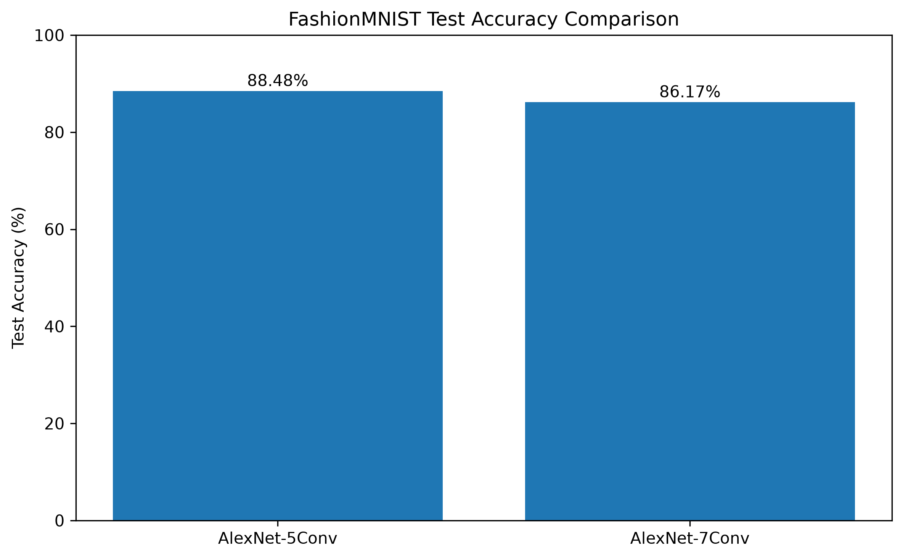
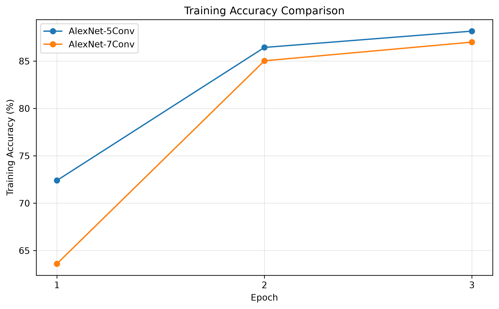
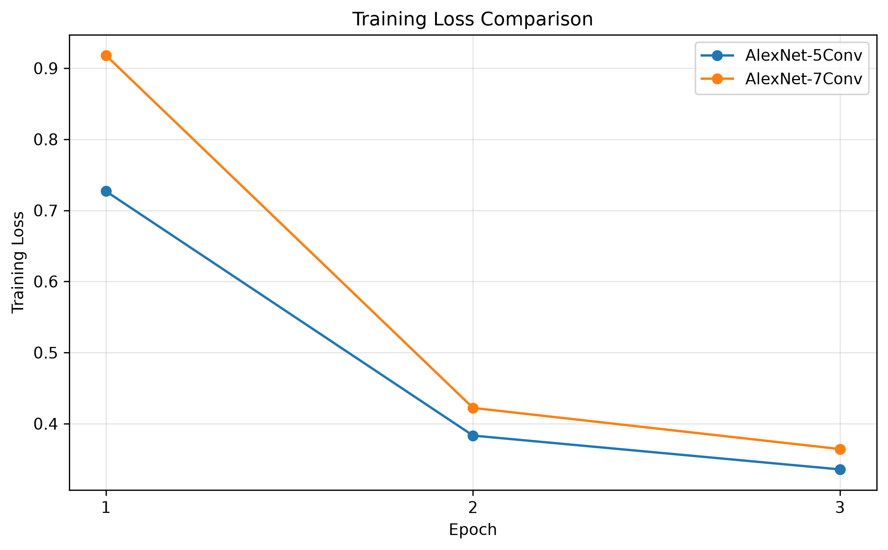
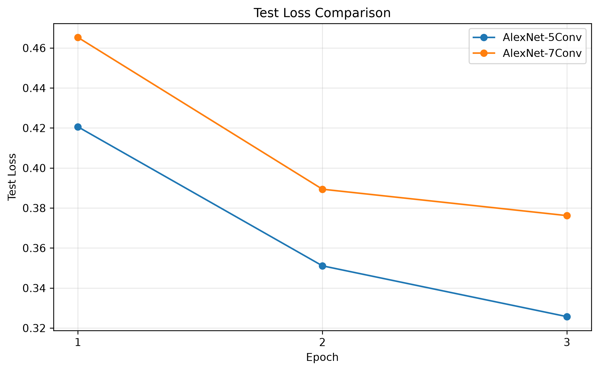

# FashionMNIST CNN: AlexNet-Style Architecture Comparison

A PyTorch deep learning project comparing two custom AlexNet-style convolutional neural network architectures on the FashionMNIST dataset.

The experiment investigates whether increasing the number of convolutional layers improves image classification performance.

## Project Overview

Two CNN architectures were trained and evaluated:

* **AlexNet-5Conv** — 5 convolutional layers
* **AlexNet-7Conv** — 7 convolutional layers

Both models use the same dataset, optimizer, learning rate, batch size, and number of epochs to ensure a fair comparison.

The experiment tracks:

* Training accuracy
* Training loss
* Test accuracy
* Test loss

## Dataset

The project uses the **FashionMNIST** dataset.

FashionMNIST contains 70,000 grayscale images across 10 clothing categories.

| Property            | Value         |
| ------------------- | ------------- |
| Training images     | 60,000        |
| Test images         | 10,000        |
| Classes             | 10            |
| Original image size | 28 × 28       |
| Model input size    | 112 × 112     |
| Channels            | 1 (grayscale) |

The images are resized to 112 × 112 pixels and normalized using a mean of 0.5 and standard deviation of 0.5.

## Technologies

* Python
* PyTorch
* Torchvision
* TensorBoard
* Matplotlib

## Model Architectures

### AlexNet-5Conv

The first model contains five convolutional layers followed by fully connected classification layers.

### AlexNet-7Conv

The second model extends the architecture to seven convolutional layers.

Both models use:

* Convolutional layers
* ReLU activation
* Max pooling
* Dropout
* Fully connected layers
* Cross-entropy loss

These are **custom AlexNet-style architectures**, rather than an exact implementation of the original AlexNet architecture.

## Training Configuration

| Parameter         | Value              |
| ----------------- | ------------------ |
| Batch size        | 128                |
| Learning rate     | 0.001              |
| Optimizer         | Adam               |
| Loss function     | Cross-Entropy Loss |
| Epochs            | 3                  |
| Input size        | 112 × 112          |
| Number of classes | 10                 |
| Device            | CPU                |

## Results

The final verified results were:

| Model             | Train Accuracy | Test Accuracy |  Test Loss |
| ----------------- | -------------: | ------------: | ---------: |
| **AlexNet-5Conv** |     **88.16%** |    **88.48%** | **0.3257** |
| AlexNet-7Conv     |         87.00% |        86.17% |     0.3762 |

### Final Test Accuracy



The 5-convolution model achieved **88.48%** test accuracy, outperforming the 7-convolution model by **2.31 percentage points**.

## Training Accuracy



Both models improved their training accuracy over the three epochs.

## Training Loss



Training loss decreased for both architectures throughout training.

## Test Loss



The 5-convolution model achieved a lower final test loss than the 7-convolution model.

## TensorBoard

The training script records training and testing metrics using TensorBoard.

To launch TensorBoard after running the training script:

```bash
tensorboard --logdir runs/alexnet_experiment
```

Then open the TensorBoard address shown in the terminal.

The TensorBoard logs are intentionally excluded from GitHub using `.gitignore`.

## Project Structure

```text
fashionmnist-cnn-pytorch/
│
├── images/
│   ├── accuracy_comparison.png
│   ├── training_accuracy_comparison.png
│   ├── training_loss_comparison.png
│   └── test_loss_comparison.png
│
├── fashionmnist_cnn.py
├── fashionmnist_cnn.ipynb
├── create_results_plot.py
├── requirements.txt
├── README.md
└── .gitignore
```

The FashionMNIST dataset and TensorBoard logs are not included in the repository because they are automatically downloaded/generated when needed.

## How to Run

### 1. Clone the repository

```bash
git clone https://github.com/Rajesh-code11/fashionmnist-cnn-pytorch.git
cd fashionmnist-cnn-pytorch
```

### 2. Install dependencies

```bash
pip install -r requirements.txt
```

### 3. Run the training script

```bash
python fashionmnist_cnn.py
```

The FashionMNIST dataset will be downloaded automatically if it is not already available.

### 4. View TensorBoard

```bash
tensorboard --logdir runs/alexnet_experiment
```

## Key Learning Outcomes

This project provided practical experience with:

* PyTorch CNN development
* Convolutional neural network architecture
* Image preprocessing
* Pooling layers
* ReLU activation
* Dropout regularization
* Adam optimization
* Cross-entropy loss
* Training and testing evaluation
* TensorBoard experiment tracking
* Comparing neural network architectures

## Analysis

The **AlexNet-5Conv** architecture performed better than the deeper 7-convolution architecture under the same training configuration.

The final test accuracy difference was:

```text
88.48% - 86.17% = 2.31 percentage points
```

The results demonstrate that increasing network depth does not automatically improve performance. A deeper architecture may introduce additional complexity without providing better results for a particular dataset and training configuration.

## Conclusion

This experiment successfully compared two custom AlexNet-style CNN architectures on FashionMNIST.

The AlexNet-5Conv model achieved the best result with **88.48% test accuracy**, compared with **86.17%** for AlexNet-7Conv.

The project demonstrates the complete workflow of building, training, evaluating, visualizing, and comparing convolutional neural networks using PyTorch.
